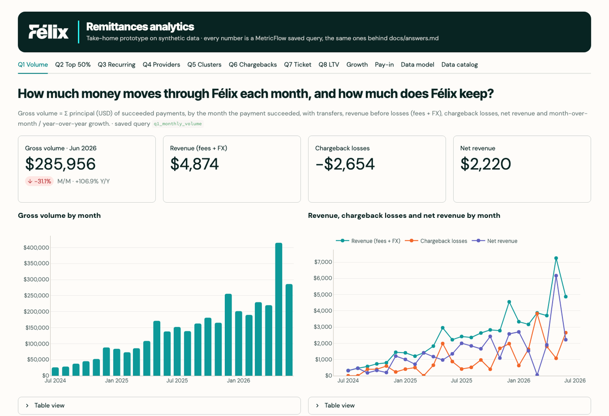

# Félix Remittances: dbt + DuckDB take-home

[](https://github.com/nelchongo/felix-remittances-dbt/actions/workflows/ci.yml)

Data Engineering Manager take-home for Félix Pago ([brief](docs/ASSIGNMENT.md)). The answers are in
[`docs/answers.md`](docs/answers.md) and the design is in [`docs/DESIGN.md`](docs/DESIGN.md).

## Run it

You need Python 3.11+ and git. There is no database server and no Docker: the warehouse is a DuckDB file.

```bash
git clone https://github.com/nelchongo/felix-remittances-dbt.git && cd felix-remittances-dbt
python -m venv .venv && source .venv/bin/activate && pip install -r requirements.txt   # Windows: .venv\Scripts\activate
python run.py
```

`python run.py` starts from the original data every time and opens a menu. The dashboard is already running in
the background, and its link is at the top of the menu.

- **1 · Run sequentially** (about 3 minutes): ingest → staging → intermediate → snapshots → core → marts →
  metrics, one `dbt build --select tag:<step>` per step, with every test. The terminal shows the steps as
  connected dots on the left and the live dbt output on the right.
- **2 · Add a monthly test batch**: loads new data and runs the same sequence incrementally (about 10 seconds).
- **3 · Run the checks**: dbt test, pytest, ruff and sqlfluff.
- **4 · Open the dashboard**: one tab per question, in Félix Pago's colors, plus the data model (bus matrix) and
  the dbt docs (every table, column and lineage). Refresh it after each run.



## Where the brief is answered

| Brief | Where |
|---|---|
| Ingest the CSVs into `raw`, **no seeds** | `src/load_raw.py` (file-level incremental) |
| First layer: dedupe and schema patterns | `dbt/models/staging/` |
| Intermediate layer by business context | `dbt/models/intermediate/` |
| Data modelling | Kimball marts in `dbt/models/marts/`, SCD2 snapshots in `dbt/snapshots/` |
| The six metrics, plus ATV, LTV, ARPU, MoM and YoY | MetricFlow in `dbt/models/semantic/` → `docs/answers.md` |
| Data tests | 258 dbt tests, unit tests, pytest, and edge-case and incremental checks |

## Without the menu (scripts and CI)

```bash
python run.py all                # reset the data and run the whole sequence
python run.py test               # dbt test + pytest
python run.py lint               # ruff + sqlfluff
python run.py check-incremental  # incremental facts equal a full refresh after late-arriving data
python run.py check-edge-cases   # 6 bad rows: exactly the expected 7 tests fail and 1 warns
python run.py --help             # every command
```

Changes go through a pull request. CI runs these commands on Python 3.11 and 3.13, and nobody pushes to `main`.
