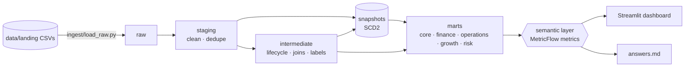
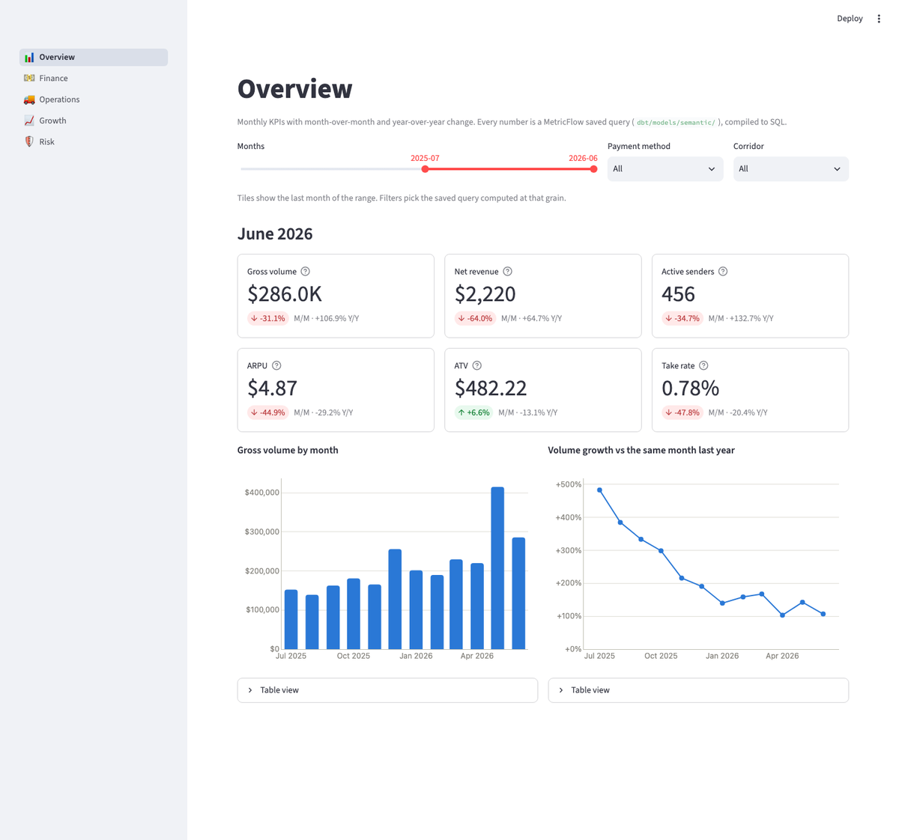
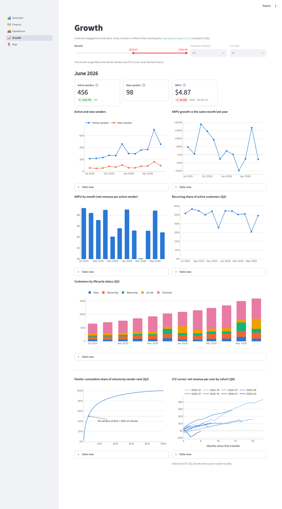
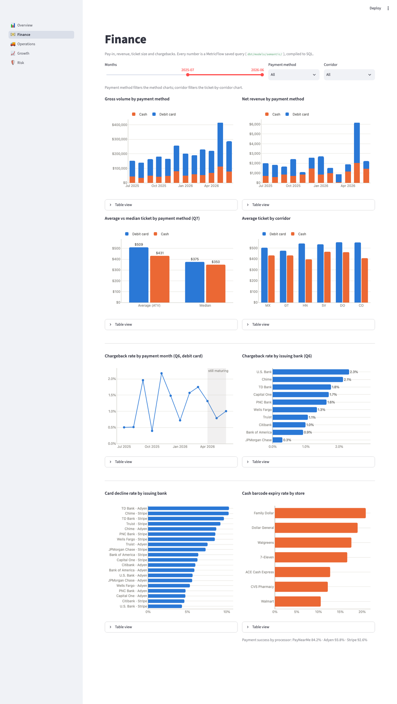
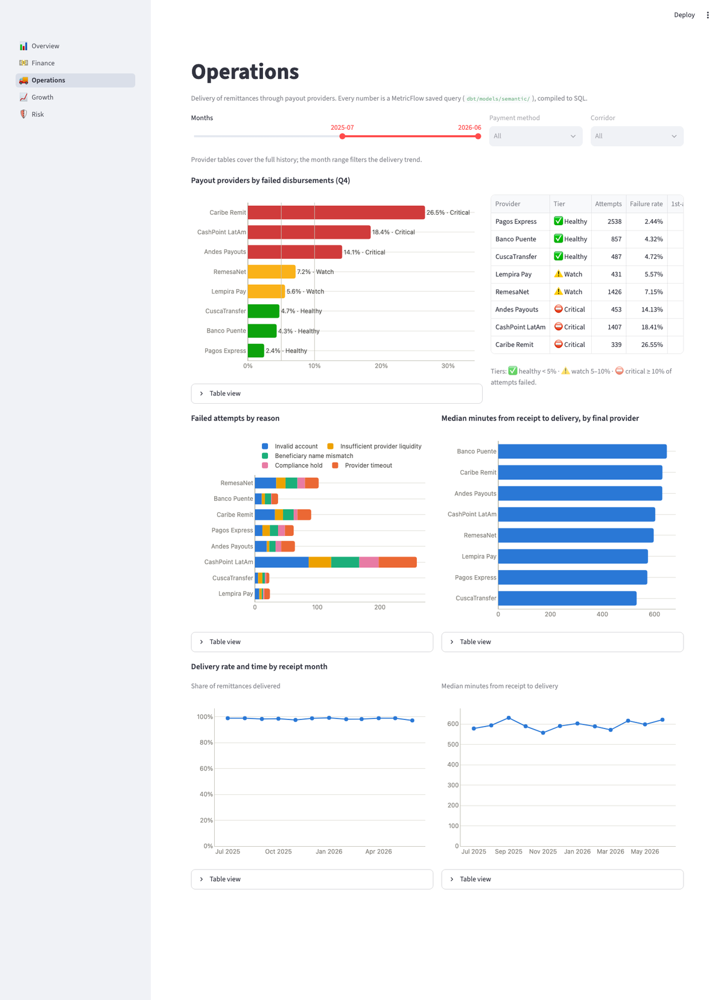
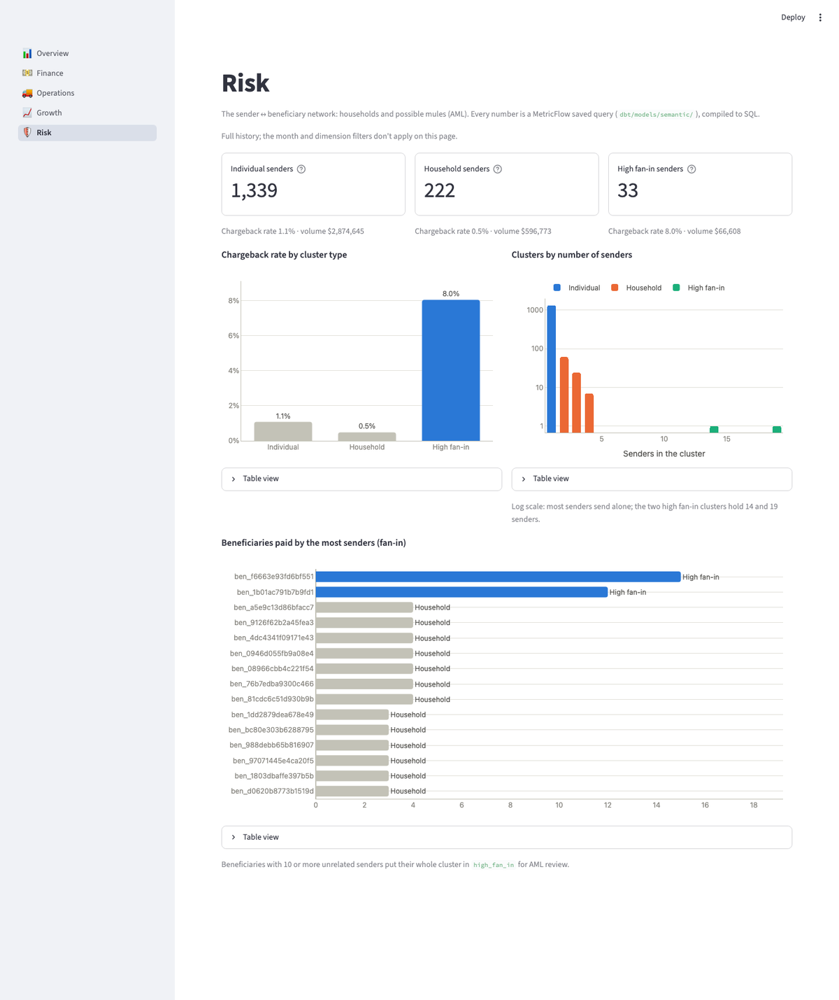

# Félix Remittances: dbt + DuckDB analytics project

[](https://github.com/nelchongo/felix-remittances-dbt/actions/workflows/ci.yml)

A take-home for the **Data Engineering Manager** role at Félix Pago: a remittance data warehouse built with **dbt** on **DuckDB**, modelled with **Kimball** data marts, **SCD2 snapshots** and a **MetricFlow semantic layer**, with a **Streamlit** dashboard on top.

It runs on any machine with **Python only**. There's no database server and no Docker requirement.

> The answers to the questions are generated from the semantic layer by `python run.py answers` (see [Answers](#answers)).

---

## Quickstart

```bash
git clone <this repo> && cd felix-remittances-dbt
python -m venv .venv && source .venv/bin/activate      # Windows: .venv\Scripts\activate
pip install -r requirements.txt

python run.py all          # load data → build SCD2 history → dbt build (models + tests) → metrics → answers
python run.py dashboard    # open http://localhost:8501
```

Requirements: Python 3.11+ (tested on 3.13). Everything else comes from `requirements.txt`, with pinned versions that were tested together.

| Command | What it does |
|---|---|
| `python run.py setup` | `dbt deps` + `dbt debug` |
| `python run.py all` | `reset-data` → `replay` → `build` → `mf validate-configs` → `compile-metrics` → `answers` (about 4 minutes) |
| `python run.py reset-data` | restore `data/landing` to the untouched baseline and delete the warehouse |
| `python run.py load` | load new or changed landing CSVs into `raw` (file-level incremental) |
| `python run.py replay` | first load month by month, with `dbt snapshot` after each step (SCD2 history) |
| `python run.py build` | `dbt build` (models, snapshots, tests) |
| `python run.py add-batch 2026-07` | load a monthly test increment, snapshot and build (also `2026-08`, `2026-09`, `edge_cases`) |
| `python run.py compile-metrics` | MetricFlow SQL of every saved query → `dashboard/compiled/*.sql` |
| `python run.py answers` | run every saved query → `docs/answers.md` + the block below |
| `python run.py dashboard` | Streamlit dashboard on http://localhost:8501 |
| `python run.py test` | `dbt test` + `pytest tests_py` (semantic-layer reconciliation, dashboard pages) |
| `python run.py lint` | `sqlfluff lint dbt/models` |

Optional: `make all`, or `docker build -t felix . && docker run --rm felix` (both just call `run.py`).
Contributors: `pip install pre-commit && pre-commit install` (whitespace, YAML, sqlfluff).

**Querying directly.** `run.py` sets the environment for you. To use the tools by hand, export absolute paths
from the repo root (relative ones break as soon as you `cd dbt`):
```bash
export DBT_PROJECT_DIR=$PWD/dbt DBT_PROFILES_DIR=$PWD/dbt DUCKDB_PATH=$PWD/warehouse/felix.duckdb DO_NOT_TRACK=1
dbt build --select staging+
cd dbt && mf query --metrics gross_volume_usd,gross_volume_usd_yoy_pct --group-by metric_time__month
```

---

## Architecture



| Layer | Schema | What happens |
|---|---|---|
| Raw | `raw` | CSVs loaded **as text** by a Python loader (**no dbt seeds**). File-level incremental with an ingestion log (new / changed / removed files) |
| Staging | `staging` | 1:1 with sources: types cast, values normalised, CDC versions deduped (`*_events` keep the history) |
| Intermediate | `intermediate` | payment lifecycle, remittance joins, FX revenue, classification labels, sender graph clusters |
| Snapshots | `snapshots` | SCD Type 2 history of users (KYC, state) and beneficiaries (payout method, account) |
| Marts | `core`, `finance`, `operations`, `growth`, `risk` | Kimball star schemas: conformed dimensions + facts with **additive measures only** |
| Semantic layer | — | Every metric formula (rates, ATV, ARPU, LTV, MoM, YoY) is defined once in YAML and computed at query time |

**Key design decisions** (details in [`docs/DESIGN.md`](docs/DESIGN.md) and [`docs/adr/`](docs/adr/)):
- **Facts store ingredients, the semantic layer stores the formulas.** No ratios or averages are stored. ARPU is right at month, quarter or corridor grain because the distinct sender count is recomputed each time.
- **Kimball data marts by business process:**
  - **finance**: pay-in, revenue, chargebacks
  - **operations**: payouts
  - **growth**: customer value and engagement
  - **risk**: the sender ↔ beneficiary network
- **SCD2 with dbt snapshots.** Facts join the user/beneficiary version that was valid *at the time of the event*.
- **No seeds.** Reference attributes live in `vars` and are turned into SQL by a macro.
- **Macros** handle cleaning, dedupe, point-in-time joins, unknown members and FX revenue. Custom generic tests enforce the modelling rules.
- **YAML-first metadata.** Every model and column is documented, contracts are enforced on marts, and owners, PII flags and additivity are recorded in `meta`.

### Data marts and facts

| Mart | Facts (Kimball type) | Questions |
|---|---|---|
| finance | `fct_payments` (transaction), `fct_chargebacks` (transaction) | monthly volume, chargeback rate, average transaction value, pay-in performance |
| operations | `fct_remittances` (accumulating snapshot), `fct_disbursement_attempts` (transaction) | payout providers by failed disbursements |
| growth | `fct_customer_activity_monthly` (periodic snapshot) | top-50% users, recurring customers, LTV, ARPU, MoM, YoY |
| risk | `bridge_user_beneficiary` (factless bridge), `dim_sender_clusters` | clusters of users sending to the same beneficiaries |
| core | `dim_users`², `dim_beneficiaries`², `dim_payment_methods`, `dim_payment_processors`, `dim_funding_institutions`, `dim_payout_providers`, `dim_corridors`, `dim_date` | conformed dimensions (² = SCD2) |

---

## Data

The brief's CSVs weren't attached, so `scripts/generate_sample_data.py` builds realistic synthetic data (deterministic, seed 42). It has 2,500 users and 24 months of baseline (2024-07 → 2026-06), plus 3 monthly test batches. See [`data/README.md`](data/README.md).

- **Pay-in:** `debit_card` (processor Adyen/Stripe, funded by the customer's US bank) or `cash` (barcode paid at a store such as 7-Eleven or Walmart, through PayNearMe). Names are illustrative.
- **Payout:** bank deposit, cash pickup or mobile wallet, through per-country payout providers, with retries.
- **Planted patterns** for every metric, plus intentional data-quality issues (duplicates, CDC versions, mixed timestamp formats, thousands separators, orphans).
- `data/source/` is never modified. `data/landing/` is the working copy, and `data/test_batches/` holds increments and edge cases.

---

## Metric definitions

| Metric | Definition |
|---|---|
| **Volume transacted** | Σ principal (USD) of succeeded payments, by month of success |
| **Top-50% users** | users ranked by volume. Those whose cumulative share reaches 50% (crossing user included) are `top_50pct` |
| **Recurring customer** | active in month M **and** in ≥ 2 of the previous 3 months (monthly payday habit). Also new / returning / at-risk / churned |
| **Provider classification** | payout attempt failure rate → `healthy` < 5% · `watch` 5–10% · `critical` ≥ 10% (min. 100 attempts) |
| **Sender clusters** | connected components of the user ↔ beneficiary graph → `individual` · `household` · `high_fan_in` (≥ 10 unrelated senders: AML review) |
| **Chargeback rate** | charged-back ÷ succeeded **debit card** payments (cash can't be charged back). By payment month (cohort) and by chargeback month |
| **ATV** | volume ÷ transfers, plus the median (tickets are skewed) |
| **Net revenue** | Félix fee + FX revenue (spread vs mid-market rate) − chargeback losses. The store fee is a pass-through |
| **ARPU** | net revenue ÷ active senders in the period |
| **MoM / YoY** | `(current − previous) / previous` with a 1-month / 1-year offset |
| **LTV** | historical (lifetime net revenue per sender), cohort curves, and a simple 12-month projection (ARPU × expected lifetime from churn) |

All formulas live in `dbt/models/semantic/metrics/` (68 metrics, each with a label and description) and the
answers are saved queries in `dbt/models/semantic/saved_queries.yml`.

---

## Answers

<!-- ANSWERS:START -->
_Generated by `python run.py answers` on 2026-11-01 20:45 UTC from the semantic layer. Full tables and definitions: [docs/answers.md](docs/answers.md)._

| # | Question | Answer |
|---|---|---|
| Q1 | Total amount transacted by month | In 2026-06 Félix moved $285,956 (+106.9% year over year, -31.1% month over month). The peak month was 2026-05 ($414,973), driven by the seasonal peaks. |
| Q2 | Users that represent 50% of the volume | 93 of 1,594 senders (5.8%) make up half of the volume ($1,771,568). They are flagged `top_50pct` in `dim_users.volume_segment`. |
| Q3 | Recurring customers | In 2026-06, 224 of 456 active customers were recurring (49.1%); monthly churn was 14.3%. Over the last 12 months the recurring share ranged from 30.8% to 56.6%. |
| Q4 | Payout providers by failed disbursements | Pagos Express is the most reliable provider (2.4% of attempts fail) and Caribe Remit the least (26.5%). Critical tier: Andes Payouts, CashPoint LatAm, Caribe Remit; retries rescue most failed first attempts. |
| Q5 | Clusters of users sending to the same beneficiaries | 33 senders sit in high fan-in clusters (beneficiaries paid by 10+ unrelated senders) with a chargeback rate of 8.0%, versus 1.1% for individual senders, and 222 senders form households sharing beneficiaries. High fan-in clusters are the AML review queue. |
| Q6 | Chargeback rate | 1.2% of succeeded debit card payments were charged back (0.9% of card volume). By issuing bank it ranges from 0.3% (JPMorgan Chase) to 2.3% (U.S. Bank). Cash can't be charged back; the latest months are still maturing. |
| Q7 | Average transaction value | Debit card: ATV $509.31, median $375.30; Cash: ATV $431.49, median $350.00. The median sits well below the mean: a few large senders skew the average. |
| Q8 | Customer lifetime value | Each sender has generated $22.26 of net revenue so far (FX is 65.8% of gross revenue; chargeback losses take $23,638). At 2026-06 ARPU and churn, the projected 12-month LTV is $33.99. |
| Growth | Growth KPIs: active senders, ARPU, MoM and YoY | In 2026-06: 456 active senders (+132.7% Y/Y), 98 new, ARPU $4.87 (-44.9% M/M, -29.2% Y/Y). |
| Pay-in | Pay-in performance by processor, bank and store | Card declines range from 4.3% (U.S. Bank) to 10.3% (TD Bank); cash barcodes expire unpaid from 10.5% (Walmart) to 20.8% (Family Dollar). |
<!-- ANSWERS:END -->

---

## Testing

| Layer | What runs |
|---|---|
| Sources / staging | keys, accepted values, parsed timestamps, relationships (orphans **warn**), row-level business rules on the payment event history (amount > 0, `fx_rate ≤ reference rate`, card / cash limits, no cash chargebacks, `card_last4` only on cards) |
| Intermediate / marts | enforced contracts, PK + FK relationships to every dimension (unknown members), `scd2_no_overlap`, `share_at_least` (top segment ≥ 50% of volume), **`no_derived_metrics_in_facts`**, accepted values on labels |
| Unit tests (dbt) | chargeback keeps `succeeded_at`, FX revenue + remittance status, Pareto boundary (crossing user is top), transitive cluster merge, recurring / at-risk lifecycle |
| Semantic layer | `mf validate-configs`; pytest runs every saved query and reconciles MetricFlow with the facts (volume, net revenue, ARPU × active senders, chargeback rate, YoY, distinct counts per grain) |
| Dashboard | Streamlit `AppTest` renders every page and checks the filters |
| Edge cases | `python scripts/check_edge_cases.py` loads 6 bad rows and asserts that **exactly** the expected tests fail (see [`docs/edge_cases.md`](docs/edge_cases.md)) |

CI (GitHub Actions, Python 3.11 and 3.13) runs `all`, `test`, `lint` and the edge-case check on every push,
and uploads the generated `docs/answers.md`.

---

## Dashboard

`python run.py dashboard` opens five pages: Overview, Finance, Operations, Growth and Risk. The dashboard runs SQL
**compiled by MetricFlow** from saved queries, so no formula lives in plotly or pandas: the payment-method and
corridor filters pick a saved query computed at that grain. It reads DuckDB through short-lived **read-only**
connections, so `dbt build` can run while it's open. Every chart has a table view.

| Overview | Growth |
|---|---|
|  |  |

| Finance | Operations | Risk |
|---|---|---|
|  |  |  |

---

## Repository layout

```
run.py · requirements.txt · CLAUDE.md · Makefile · Dockerfile · .sqlfluff · .pre-commit-config.yaml
data/        source/ · test_batches/ · landing/ (generated) · README.md
ingest/      load_raw.py                       # CSV landing → raw (no seeds)
scripts/     generate_sample_data.py · render_answers.py · check_edge_cases.py
dbt/         dbt_project.yml · profiles.yml · macros/ · snapshots/ · tests/
             models/{staging,intermediate,marts,semantic}/
dashboard/   app.py · pages/ · db.py · theme.py · components.py · compiled/ (generated)
tests_py/    semantic-layer and dashboard tests
docs/        ASSIGNMENT · DESIGN · IMPLEMENTATION_PLAN · answers.md (generated) · edge_cases.md · adr/ · img/
.github/     workflows/ci.yml
```

## Implementation notes (where the build differs from DESIGN.md)

- **Intermediate access is `protected`**, not `private`: dbt only lets a private model be referenced from its own
  group, and marts and snapshots in other groups need the intermediate models.
- **Replay feeds user versions in passes inside each month.** Most KYC approvals happen days after sign-up; a
  plain monthly snapshot captured 6.6% of users with history instead of the 40% in the data ([ADR 0002](docs/adr/0002-scd2-snapshots-replay.md)).
- **Row-level source rules sit on `stg_felix_backend__payment_events`**, so each bad row trips its own test in a
  single `dbt build` (tests on downstream models are skipped once staging fails).
- **SCD2 joins in MetricFlow resolve at day granularity**; the facts' own point-in-time keys use exact timestamps.
- **Net revenue subtracts chargeback losses**, so historical LTV is about $22 per sender; fees + FX alone are
  about $37 (the figure quoted in `data/README.md`).
- Source freshness passes right after a load (it uses the load time) and warns after 24 hours.

## Path to production
- Swap the profile to Snowflake or BigQuery.
- CDC ingestion (Debezium/Fivetran) replaces the CSV landing, and snapshots run daily under an orchestrator.
- The same semantic layer serves BI tools through the dbt Semantic Layer APIs.
- Add PII masking per environment and data contracts with the backend teams.

Details in [`docs/DESIGN.md` §17](docs/DESIGN.md).
