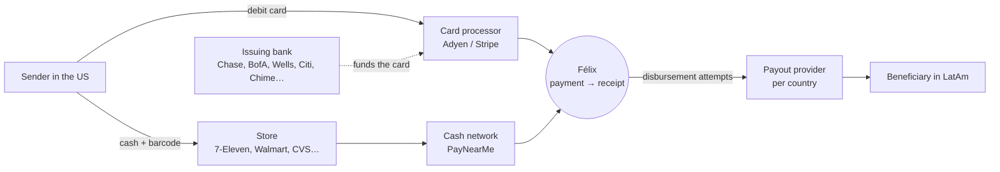
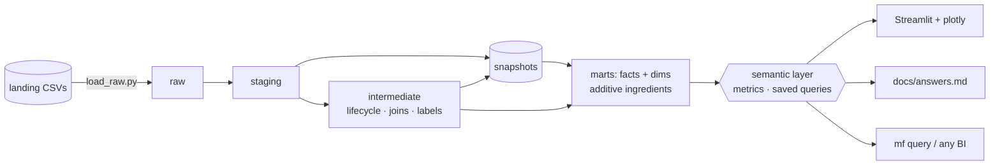

# Félix Remittances: dbt Project Design (v8)

> Take-home for the Data Engineering Manager role at Félix Pago.
> This is the plan for **what we build, why, and in what order**. It doubles as the repo's architecture note.
>
> **Implementation:** see `CLAUDE.md` (rules for Claude Code) and `docs/IMPLEMENTATION_PLAN.md` (phases 0–8).
>
> **Changelog**
> - **v8 (menu, step sequence and brand):** `python run.py` resets the data (so option 1 is always the full first
>   run), clears the screen and opens a menu under the Félix logo,
>   with the dashboard already running in the background and a clickable link. Option 1 runs the sequence step by step
>   (`run.py pipeline`): ingest, then one `dbt build --select tag:<step>` per tag (`staging`, `intermediate`, `snapshot`,
>   `core`, `marts`), then the semantic layer. The first run ingests and builds everything; later runs are
>   incremental. The terminal splits in two: connected dots on the left (the marts step fans out into the four
>   groups dbt builds in parallel), live dbt output on the right. The dashboard uses Félix Pago's logo and colors,
>   validated as chart palettes (§14).
> - v7 (pull-request workflow, load-time incremental, `src/`): CI runs every check on every pull request to `main`/`master` (one job per
>   Python version, 3.11 and 3.13), and `main` only changes through a reviewed PR. Python is linted with `ruff`. The README
>   is only the step-by-step guide; the ADRs, the edge-case notes and the implementation notes moved into this
>   document (§15, §18, §19). `.sqlfluff` and `scripts/check_edge_cases.py` were folded into `run.py`. Every Python file except
>   `run.py` lives in `src/`. The incremental facts use a load-time watermark, proven by `run.py check-incremental` (§15.4).
> - v6 (simplification after the first build): the dashboard is one page with a tab per question that reads the
>   same saved queries as `docs/answers.md` (no dashboard-only saved queries, semantic models or filters). No
>   Makefile, Dockerfile or pre-commit: `run.py` and CI are the only entry points. The loader moved to `scripts/`.
> - v5: **facts store ingredients, the semantic layer stores the formulas.** No rates, averages or growth % are stored in tables. Metrics are defined once in a **MetricFlow semantic layer** (dbt, open source, DuckDB-native) and plotly only draws them. New growth metrics: **ARPU, MoM, YoY**. History extended to 24 months so YoY is real.
> - v4: debit card / cash pay-in with processor + funding institution (bank or store). ATV and LTV. Streamlit dashboard. Test-data workflow.
> - v3: no dbt seeds, plain Python runner (Docker optional).
> - v2: Kimball data marts, SCD2 snapshots, macro library, YAML-first metadata.

---

## 1. Requirements → solution

| Brief / goal | Solution |
|---|---|
| dbt on any warehouse | **DuckDB** (a file, no server) via `dbt-duckdb`. A `postgres` profile is included as an alternative |
| Raw schema, **no seeds** | `src/load_raw.py` loads `data/landing/<table>/*.csv` → `raw.<table>`. **No `seeds/` folder.** Reference attributes live in `vars` and are turned into SQL by a macro |
| First layer: dedupe + schema patterns | `staging/`, cleaned and deduped with macros |
| Intermediate by business context | `intermediate/{payments,disbursements,remittances,customers}` |
| Data modelling | **Kimball**: 4 business-process marts + conformed dimensions. **Facts hold only additive base measures** |
| Metrics | **Semantic layer (MetricFlow YAML)**: every formula (rates, averages, ARPU, LTV, MoM, YoY) is defined once, versioned and tested. Answers are **saved queries** |
| SCD2 | dbt **snapshots** → `dim_users`, `dim_beneficiaries` |
| Metadata | `_<folder>__models.yml`: descriptions, `data_type`, contracts, tests, `meta` (owner, PII, **additivity**) |
| Data tests | generic, `dbt_utils`, custom generic, singular, unit, contracts, freshness, `mf validate-configs` |
| Test with more data | `data/source` (untouched) → `data/landing` (working copy) + `test_batches/{2026-07,08,09,edge_cases}` |
| Dashboard | **Streamlit + plotly** running semantic-layer SQL read-only against DuckDB |
| Runs anywhere | Python 3.11+ (tested on 3.13): `pip install -r requirements.txt`, then `python run.py all`. Docker optional |

**Open points for the recruiter:** (1) the PDF mentions *"another doc HERE"* but the link is missing. (2) Only 3 sources are listed. `users.csv` is our addition, and users can be derived from transactions if needed.

---

## 2. Business model the data reflects



| Provider role | Column | Examples | Dimension |
|---|---|---|---|
| **Payment processor** (pay-in), who collects the money | `payment_processor` | Adyen, Stripe (cards). PayNearMe (cash) | `dim_payment_processors` |
| **Funding institution** (pay-in), where the money comes from | `funding_institution` (+ type) | issuing bank (`bank` / `neobank`) or store (`retailer`) | `dim_funding_institutions` |
| **Payout provider**, who delivers the money | `provider_name` (disbursements) | per corridor | `dim_payout_providers` |

**Revenue** = Félix fee + **FX revenue** (`send × (1 − fx_rate / reference_fx_rate)`). The store commission is a pass-through. **Loss** = principal of charged-back card payments.

---

## 3. Stack & how to run

| Concern | Choice |
|---|---|
| Warehouse | DuckDB file `warehouse/felix.duckdb` |
| Transform | `dbt-core` + `dbt-duckdb` + `dbt_utils`, versions pinned |
| Semantic layer | **`dbt-metricflow`** (MetricFlow, Apache 2.0 since Oct 2025, ships a DuckDB SQL renderer). CLI: `mf` |
| Dashboard | `streamlit` + `plotly` + `duckdb` |
| Runner | **`run.py`** (cross-platform), the single entry point: a menu with no arguments, commands for scripts and CI |
| Quality | `ruff` (Python), `sqlfluff` (dbt SQL), `pytest` (semantic-layer reconciliation, dashboard smoke test), GitHub Actions on every pull request (§15.2) |

```bash
pip install -r requirements.txt
python run.py                      # menu: dashboard in the background + 1 = run sequentially (first run or incremental)
python run.py pipeline             # the dbt sequence without the menu
python run.py all                  # reset-data, then load (monthly replay) → dbt build → mf validate-configs → compile dashboard metrics
python run.py answers              # runs every saved query and writes docs/answers.md (the 8 answers)
python run.py dashboard            # http://localhost:8501
python run.py add-batch 2026-07    # incremental test data → snapshot → build → recompile
python run.py reset-data           # landing/ back to the untouched baseline
python run.py test                 # dbt test + pytest
python run.py lint                 # ruff + sqlfluff
python run.py check-incremental    # incremental facts = full refresh after late-arriving data (§15.4)
python run.py check-edge-cases     # the edge-case batch fails exactly the expected tests (§15.1)
mf query --metrics gross_volume_usd,gross_volume_usd_mom_pct,gross_volume_usd_yoy_pct --group-by metric_time__month   # ad hoc
```

**Version pinning: verified.** A spike on 2026-11-01 ran a toy project end to end on `dbt-core 1.12.6 · dbt-duckdb 1.11.1 · dbt-metricflow 0.15.0 (metricflow 0.213.0) · duckdb 2.0.0` (Python 3.13). The following all work: YAML snapshots (business-time `dbt_valid_from`), the `time_spine` config, `sum_boolean` / `median` / `count_distinct` measures, filtered ratio metrics, derived metrics with `offset_window` 1 month / 1 year, `saved_queries`, `mf validate-configs`, and `mf query --csv` / `--explain`. Pins are in `requirements.txt`, and the spike's gotchas are in `CLAUDE.md`. The YAML below uses the `semantic_models:` + `metrics:` spec.

---

## 4. Data & ingestion: untouched original + test data

```
data/
├── source/            # baseline extract (transactions 2024-07 → 2026-06). NEVER edited
├── test_batches/      # 2026-07/, 2026-08/, 2026-09/ (new rows + late updates) · edge_cases/ (bad rows)
└── landing/           # working copy the loader reads: landing/<table>/<table>__<batch>.csv (git-ignored)
```
- **Loader:** file-level incremental using `raw._ingestion_log` (file name + MD5). A new file is inserted, a changed file is reloaded, a removed file's rows are deleted. Columns `_source_file`, `_file_md5`, `_loaded_at` and `_batch_id` are added. `union_by_name` tolerates new columns.
- **Replay:** the first load feeds the baseline month by month, with `dbt snapshot` after each month, so SCD2 history exists. Inside a month, user versions are fed in passes (pass k = each user's k-th version that month) because most KYC approvals land days after sign-up; the timestamp strategy keeps business-time validity, so all ~40% of users with several versions are captured.
- **Test batches** contain new rows *and* late updates to old ones (chargebacks 10–75 days later, KYC approvals, beneficiary changes, in-flight payouts resolving). `edge_cases/` has 6 bad rows that each trip a specific test.

---

## 5. Modelling principle: facts store ingredients, the semantic layer stores the formulas

**Rule:** tables keep the **lowest useful grain** and only **additive base measures** (amounts, 0/1 flags, counts), plus the dimensions to slice them. Anything that is a **ratio, average, median, distinct count, share, cumulative or period-over-period comparison** is defined as a metric in the semantic layer and calculated at query time, at whatever grain is asked for.

Why:
- **Correct at any grain.** Monthly ARPU, quarterly ARPU and ARPU by corridor all re-compute `revenue ÷ distinct senders` properly. A stored monthly ARPU can't be rolled up to a quarter, and averaging averages is wrong.
- **One definition.** "Chargeback rate" means the same thing in the dashboard, the README answers and an ad-hoc `mf query`. Changing a definition is one YAML PR, with no backfill.
- **Kimball-aligned.** Facts hold additive facts. Non-additive measures are computed in the reporting layer.

| Kind | Stored in tables? | Examples |
|---|---|---|
| Additive measures | ✅ facts | `send_amount_usd`, `fee_revenue_usd`, `fx_revenue_usd`, `chargeback_loss_usd`, `is_succeeded`, `is_failed`… |
| Semi-additive | ✅ periodic snapshot only, flagged in `meta` | `cumulative_net_revenue_usd` per user-month (sums across users, **not** across months) |
| Classification labels (a business rule applied to an entity) | ✅ as **dimension attributes** | `volume_segment` (Q2), `lifecycle_status` / `is_recurring` (Q3), `reliability_tier` (Q4), `cluster_type` (Q5). The brief explicitly asks to *classify*, and labels are needed to group by |
| Ratios, averages, medians, distinct counts, % of total, MoM, YoY, ARPU, LTV | ❌ semantic layer | `chargeback_rate`, `atv_usd`, `arpu_usd`, `gross_volume_usd_yoy_pct`… |
| Presentation-only maths | ❌ plotly/pandas | % of total in a pie chart, cumulative share for the Pareto curve, sorting |

Every fact column carries `meta: { additivity: additive | semi_additive }`, and a custom test fails if a column named `*_rate`, `*_pct`, `avg_*` or `*_ratio` appears in a fact.

---

## 6. Kimball dimensional model

### 6.1 Data marts

| Data mart | Owner | Business process | Answers |
|---|---|---|---|
| **finance** | Finance / Treasury | Pay-in, revenue, refunds, chargebacks | Q1 volume · Q6 chargebacks · Q7 ATV · pay-in performance |
| **operations** | Payout Ops | Delivery through payout providers | Q4 provider failures |
| **growth** | Growth / CRM | Customer engagement and value | Q2 top-50% · Q3 recurring · Q8 LTV · **ARPU, MoM, YoY** |
| **risk** | Risk & Compliance | Sender ↔ beneficiary network | Q5 clusters |
| **core** | Data team | Conformed dimensions + time spine | — |

### 6.2 Facts (ingredients only)

| Fact | Mart | Kimball type | Grain | Additive measures | Time columns |
|---|---|---|---|---|---|
| `fct_payments` | finance | Transaction | payment (final state) | `send_amount_usd`, `fee_revenue_usd`, `fx_revenue_usd`, `chargeback_loss_usd`, `store_fee_usd`. Flags: `is_succeeded`, `is_failed`, `is_expired`, `is_charged_back`, `is_refunded`, `is_first_transfer` | `created_at`, `succeeded_at` |
| `fct_chargebacks` | finance | Transaction | chargeback | `chargeback_amount_usd`, `days_to_chargeback` | `chargeback_at`, `payment_succeeded_at` |
| `fct_remittances` | operations | Accumulating snapshot | remittance | `send_amount_usd`, `payout_amount_local`, `n_attempts`, `minutes_to_deliver`. Flags `is_delivered`, `is_in_flight` | milestones |
| `fct_disbursement_attempts` | operations | Transaction | payout attempt | `payout_amount_usd`, `minutes_to_resolve`. Flags `is_failed`, `is_first_attempt`, `is_retry`, `is_final_attempt` | `attempted_at` |
| `fct_customer_activity_monthly` | growth | Periodic snapshot | user × month | `n_transfers`, `volume_usd`, `net_revenue_usd`, `cumulative_net_revenue_usd` (semi-additive). Flags `is_active`. Labels `lifecycle_status`, `is_recurring`, `cohort_month`, `months_since_first_transfer` | `activity_month` |
| `bridge_user_beneficiary` | risk | Factless / bridge | user × beneficiary | `n_transfers`, `volume_usd` | first/last sent |

### 6.3 Conformed dimensions (`marts/core`)

| Dimension | SCD | Notes |
|---|---|---|
| `dim_users` | **Type 2** (snapshot) + Type 1 | Type 2: kyc_status, state. Type 1: masked email/phone, `volume_segment`, `volume_rank`, `cluster_id`, `primary_payment_method`, `first_transfer_month` |
| `dim_beneficiaries` | **Type 2** (snapshot) | payout_method, account_last4, name, country |
| `dim_payment_methods` | 1 | `debit_card`, `cash` · channel, chargeback_eligible (from `vars`) |
| `dim_payment_processors` | 1 | Adyen, Stripe, PayNearMe · processor_type |
| `dim_funding_institutions` | 1 | banks / neobank / stores · institution_type |
| `dim_payout_providers` | 1 | corridors served · `reliability_tier` (Q4 label) |
| `dim_corridors` | 1 | country, currency, region |
| `dim_date` | — | also the MetricFlow **time spine** |
| `risk/dim_sender_clusters` | 1 | cluster_id, `cluster_type`, n_users, n_beneficiaries (descriptive size) |

Conventions: surrogate keys, an unknown member row, point-in-time joins to SCD2 dims, role-playing dates.

### 6.4 Bus matrix

| Fact \ Dim | Date | User² | Beneficiary² | Pay method | Processor | Funding inst. | Payout provider | Corridor | Cluster |
|---|:-:|:-:|:-:|:-:|:-:|:-:|:-:|:-:|:-:|
| fct_payments | ✔ | ✔ | ✔¹ | ✔ | ✔ | ✔ | | ✔¹ | via user |
| fct_chargebacks | ✔✔ | ✔ | ✔ | ✔ | ✔ | ✔ | | ✔ | via user |
| fct_remittances | ✔ | ✔ | ✔ | ✔ | ✔ | ✔ | ✔ | ✔ | |
| fct_disbursement_attempts | ✔ | ✔ | ✔ | | | | ✔ | ✔ | |
| fct_customer_activity_monthly | ✔ | ✔ | | | | | | | via user |
| bridge_user_beneficiary | | ✔ | ✔ | | | | | ✔ | ✔ |

¹ unknown member when there's no receipt · ² SCD2 · ✔✔ role-playing (payment date and chargeback date)

---

## 7. Semantic layer (MetricFlow)

### 7.1 Layout
```
dbt/models/semantic/
├── semantic_models/   sem_payments.yml · sem_chargebacks.yml · sem_disbursement_attempts.yml
│                      sem_remittances.yml · sem_customer_activity.yml · sem_users.yml (SCD2 validity)
├── metrics/           finance.yml · growth.yml · operations.yml · risk.yml
└── saved_queries.yml  # one per question; used by `run.py answers` and the dashboard
```

### 7.2 Semantic model example: measures only aggregate the ingredients
```yaml
semantic_models:
  - name: payments
    description: "One row per payment. Measures are base aggregations only. Formulas live in metrics/."
    model: ref('fct_payments')
    defaults: { agg_time_dimension: created_at }
    entities:
      - { name: payment, type: primary, expr: payment_id }
      - { name: user, type: foreign, expr: user_id }
      - { name: beneficiary, type: foreign, expr: beneficiary_id }
    dimensions:
      - { name: created_at,   type: time, type_params: { time_granularity: day } }
      - { name: succeeded_at, type: time, type_params: { time_granularity: day } }
      - { name: payment_method,        type: categorical }
      - { name: payment_processor,     type: categorical }
      - { name: funding_institution,   type: categorical }
      - { name: funding_institution_type, type: categorical }
      - { name: corridor,              type: categorical, expr: destination_country }
      - { name: is_first_transfer,     type: categorical }
    measures:
      - { name: payments_created,      agg: count, expr: payment_id }
      - { name: payments_succeeded,    agg: sum_boolean, expr: is_succeeded,    agg_time_dimension: succeeded_at }
      - { name: payments_failed,       agg: sum_boolean, expr: is_failed }
      - { name: payments_expired,      agg: sum_boolean, expr: is_expired }
      - { name: payments_charged_back, agg: sum_boolean, expr: is_charged_back, agg_time_dimension: succeeded_at }
      - { name: gross_volume_usd, agg: sum, expr: "case when is_succeeded then send_amount_usd end", agg_time_dimension: succeeded_at }
      - { name: fee_revenue_usd,       agg: sum, agg_time_dimension: succeeded_at }
      - { name: fx_revenue_usd,        agg: sum, agg_time_dimension: succeeded_at }
      - { name: chargeback_loss_usd,   agg: sum, agg_time_dimension: succeeded_at }
      - { name: active_senders,        agg: count_distinct, expr: "case when is_succeeded then user_id end", agg_time_dimension: succeeded_at }
      - { name: new_senders,           agg: count_distinct, expr: "case when is_succeeded and is_first_transfer then user_id end", agg_time_dimension: succeeded_at }
      - { name: ticket_median_usd,     agg: median, expr: "case when is_succeeded then send_amount_usd end", agg_time_dimension: succeeded_at }
```
`dim_users` is declared as an **SCD2 semantic model** (`validity_params: is_start / is_end` on `valid_from` / `valid_to`). A query like "chargeback rate by KYC status" then joins the user version that was valid at payment time.

### 7.3 Metric catalog

**Finance**
| Metric | Type | Formula |
|---|---|---|
| `gross_volume_usd` | simple | Σ send amount of succeeded payments (by `succeeded_at`) |
| `transfers` | simple | Σ succeeded payments |
| `net_revenue_usd` | derived | `fee_revenue_usd + fx_revenue_usd − chargeback_loss_usd` |
| `take_rate` | derived | `net_revenue_usd / gross_volume_usd` |
| **`atv_usd`** (Q7) | ratio | `gross_volume_usd / transfers` |
| `median_ticket_usd` (Q7) | simple (median) | median send amount, computed at the queried grain |
| `payment_success_rate` | ratio | `payments_succeeded / payments_created` |
| `card_decline_rate` | ratio + filter | failed ÷ created where `payment_method = debit_card` |
| `cash_expiry_rate` | ratio + filter | expired ÷ created where `payment_method = cash` |
| **`chargeback_rate`** (Q6) | ratio + filter | charged-back ÷ succeeded **debit card** payments (cohort = payment month) |
| `chargeback_rate_amount` | ratio | `chargeback_loss_usd / card gross volume` |
| `chargebacks_reported` | simple (`fct_chargebacks`, time = `chargeback_at`) | reporting-month count, for network monitoring |

**Growth**
| Metric | Type | Formula |
|---|---|---|
| `active_senders` | simple (count distinct) | senders with ≥ 1 succeeded transfer **in the queried period** |
| `new_senders` | simple | first-ever succeeded transfer in the period |
| **`arpu_usd`** | derived | `net_revenue_usd / active_senders`. Monthly ARPU at `metric_time__month`, quarterly at `__quarter`. Both are correct because the distinct count is recomputed |
| `arpu_volume_usd` | derived | `gross_volume_usd / active_senders` (volume per user) |
| **`<metric>_mom_pct`** | derived + `offset_window: 1 month` | `(current − prev) / prev` for gross volume, net revenue, transfers, active senders, ARPU |
| **`<metric>_yoy_pct`** | derived + `offset_window: 1 year` | same, vs the same month last year (12 months of YoY with the 24-month baseline) |
| `recurring_senders` / `recurring_share` (Q3) | simple / derived | users with `is_recurring` ÷ active users |
| `churned_senders`, `churn_rate` | simple / derived + offset | churned this month ÷ active last month |
| `ltv_per_cohort_user` (Q8) | ratio on the periodic snapshot | `Σ cumulative_net_revenue_usd / Σ user-months`, grouped by `cohort_month × months_since_first_transfer` = the LTV curve |
| `historical_ltv_usd` (Q8) | = `arpu_usd` **without** a time grain | lifetime net revenue ÷ lifetime senders. Same formula as ARPU, different grain, no new code |
| `projected_ltv_12m_usd` (Q8) | derived | `arpu_usd × least(1 / churn_rate, var('ltv_horizon_months'))`. A simple, transparent estimate |

**Operations**: `payout_attempts`, `payout_attempt_failure_rate` (Q4), `first_attempt_success_rate`, `rescued_by_retry_rate`, `median_minutes_to_deliver`.
**Risk**: `senders`, `beneficiaries`, `gross_volume_usd` and `chargeback_rate`, all sliceable by `user__cluster_type` (Q5).

```yaml
# metrics/growth.yml (excerpt)
metrics:
  - name: arpu_usd
    label: ARPU (net revenue per active sender)
    type: derived
    type_params:
      expr: net_revenue_usd / nullif(active_senders, 0)
      metrics: [{ name: net_revenue_usd }, { name: active_senders }]

  - name: arpu_usd_mom_pct
    label: ARPU growth % M/M
    type: derived
    type_params:
      expr: (arpu_now - arpu_prev) / nullif(arpu_prev, 0)
      metrics:
        - { name: arpu_usd, alias: arpu_now }
        - { name: arpu_usd, alias: arpu_prev, offset_window: 1 month }

  - name: gross_volume_usd_yoy_pct
    label: Volume growth % Y/Y
    type: derived
    type_params:
      expr: (vol_now - vol_last_year) / nullif(vol_last_year, 0)
      metrics:
        - { name: gross_volume_usd, alias: vol_now }
        - { name: gross_volume_usd, alias: vol_last_year, offset_window: 1 year }

  - name: chargeback_rate
    label: Chargeback rate (debit card, by payment month)
    type: ratio
    type_params:
      numerator:   { name: payments_charged_back,   filter: "{{ Dimension('payment__payment_method') }} = 'debit_card'" }
      denominator: { name: transfers,                filter: "{{ Dimension('payment__payment_method') }} = 'debit_card'" }
```
Period-over-period metrics must be queried with `metric_time` (e.g. `--group-by metric_time__month`).

### 7.4 Saved queries = the answers
```yaml
saved_queries:
  - name: q1_monthly_volume
    query_params:
      metrics: [gross_volume_usd, transfers, net_revenue_usd, gross_volume_usd_mom_pct, gross_volume_usd_yoy_pct]
      group_by: ["TimeDimension('metric_time', 'month')"]
  - name: growth_kpis_monthly
    query_params:
      metrics: [active_senders, new_senders, arpu_usd, arpu_usd_mom_pct, arpu_usd_yoy_pct, active_senders_yoy_pct]
      group_by: ["TimeDimension('metric_time', 'month')"]
  # q2 … q8, pay-in performance …
```
`python run.py answers` runs every saved query (`mf query --saved-query … --csv`) and writes `docs/answers.md`. The README answers are generated, not hand-typed.

---

## 8. Question → answer map

| # | Question | Labels (stored) | Metrics (semantic layer) | Saved query |
|---|---|---|---|---|
| Q1 | Amount transacted by month | — | `gross_volume_usd`, `transfers`, MoM, YoY | `q1_monthly_volume` |
| Q2 | Users making up 50% of volume | `dim_users.volume_segment`, `volume_rank` | `gross_volume_usd`, `active_senders` by `user__volume_segment` | `q2_volume_concentration` |
| Q3 | Recurring customers | `fct_customer_activity_monthly.is_recurring`, `lifecycle_status` | `recurring_senders`, `recurring_share`, `churn_rate` | `q3_recurring_customers` |
| Q4 | Providers by failed disbursements | `dim_payout_providers.reliability_tier` | `payout_attempt_failure_rate`, `first_attempt_success_rate` | `q4_payout_providers` |
| Q5 | Clusters sharing beneficiaries | `dim_users.cluster_id`, `dim_sender_clusters.cluster_type` | `senders`, `gross_volume_usd`, `chargeback_rate` by cluster type | `q5_sender_clusters` |
| Q6 | Chargeback rate | — | `chargeback_rate`, `chargeback_rate_amount`, `chargebacks_reported` | `q6_chargeback_rate` |
| Q7 | Average transaction value | — | `atv_usd`, `median_ticket_usd` | `q7_transaction_value` |
| Q8 | Lifetime value | `cohort_month`, `months_since_first_transfer` | `historical_ltv_usd`, `ltv_per_cohort_user`, `projected_ltv_12m_usd` | `q8_ltv` |
| G | Growth KPIs | — | `arpu_usd`, `active_senders`, `new_senders`, all `_mom_pct` / `_yoy_pct` | `growth_kpis_monthly` |
| P | Pay-in performance | — | `payment_success_rate`, `card_decline_rate`, `cash_expiry_rate` by processor / bank / store | `payin_performance` |

The labels are built in intermediate models from the facts, with thresholds in `vars`: `int_customers__volume_ranking`, `int_customers__activity_lifecycle`, `int_payout_providers__reliability` and `int_customers__sender_graph_components`.

Sample data preview: ~6% of senders make up 50% of volume. Monthly ARPU ≈ $10. YoY volume +90% to +190%. ATV is $509 on card vs $431 on cash. Historical LTV ≈ $37 average / $12 median, with ~66% of revenue from FX. The card chargeback rate is ≈ 1% (≈ 15% on transfers to the two mule beneficiaries).

---

## 9. Project structure

```
felix-remittances-dbt/
├── README.md · run.py · requirements.txt · .gitignore · CLAUDE.md
├── .github/workflows/ci.yml
├── data/  source/ · test_batches/ · landing/ · README.md
├── src/                                       # every Python file except run.py
│   ├── load_raw.py                             # CSV landing → raw (file-level incremental, no seeds)
│   ├── render_answers.py                       # saved-query results → docs/answers.md
│   ├── dashboard.py                            # Streamlit: one tab per question, read-only DuckDB
│   ├── generate_sample_data.py                 # synthetic data generator (output in data/)
│   └── tests/                                  # pytest: saved queries reconcile with facts; dashboard renders
├── warehouse/  felix.duckdb · compiled/*.sql   # generated: the warehouse and MetricFlow's SQL for the dashboard
├── docs/  ASSIGNMENT.md · DESIGN.md · IMPLEMENTATION_PLAN.md · answers.md (generated) · img/
└── dbt/
    ├── dbt_project.yml · profiles.yml · packages.yml
    ├── snapshots/   snp_users.yml · snp_beneficiaries.yml
    ├── macros/      utils/ · cleaning/ · modeling/ · tests/ · hooks/
    └── models/
        ├── docs/_glossary.md
        ├── staging/felix_backend/
        ├── intermediate/
        │   ├── payments/       int_payments__lifecycle
        │   ├── disbursements/  int_disbursements__attempts_ranked · int_payout_providers__reliability
        │   ├── remittances/    int_remittances__joined
        │   └── customers/      int_beneficiaries__attribute_changes · int_customers__volume_ranking
        │                       int_customers__activity_lifecycle · int_customers__sender_graph_components
        ├── marts/
        │   ├── _groups.yml · _exposures.yml
        │   ├── core/        dim_date (time spine) · dim_users · dim_beneficiaries · dim_payment_methods
        │   │                dim_payment_processors · dim_funding_institutions · dim_payout_providers · dim_corridors
        │   ├── finance/     fct_payments · fct_chargebacks
        │   ├── operations/  fct_remittances · fct_disbursement_attempts
        │   ├── growth/      fct_customer_activity_monthly
        │   └── risk/        bridge_user_beneficiary · dim_sender_clusters
        └── semantic/        semantic_models/ · metrics/ · saved_queries.yml
```
The marts are now **small and clean**: facts and dimensions only. The `agg_*` tables are gone, because their job moved to the semantic layer.

```yaml
# dbt_project.yml (excerpt)
models:
  felix:
    staging:      { +materialized: view, +schema: staging }
    intermediate: { +materialized: view, +schema: intermediate, +access: protected }   # private would block refs from marts in other groups
    marts:
      +materialized: table
      +access: public
      +contract: { enforced: true }
      core:       { +schema: core }
      finance:    { +schema: finance,    +group: finance }
      operations: { +schema: operations, +group: operations }
      growth:     { +schema: growth,     +group: growth }
      risk:       { +schema: risk,       +group: risk }
vars:
  volume_segments: { top: 0.50, middle: 0.80 }               # Q2 label thresholds
  recurring_lookback_months: 3
  recurring_min_active_months: 2                            # Q3
  churn_after_inactive_days: 60
  provider_failure_tiers: { healthy: 0.05, watch: 0.10 }    # Q4 label thresholds
  provider_min_attempts: 100
  mule_min_senders: 10                                      # Q5
  chargeback_maturity_days: 90
  ltv_horizon_months: 12
  payment_methods:    { debit_card: { channel: online, chargeback_eligible: true }, cash: { channel: in_store, chargeback_eligible: false } }
  payment_processors: { Adyen: { processor_type: card_acquirer }, Stripe: { processor_type: card_acquirer }, PayNearMe: { processor_type: cash_network } }
  corridors: { MX: { country_name: Mexico, region: North America }, GT: { country_name: Guatemala, region: Central America }, … }
```

---

## 10. Layers



**Staging**: one model per source, macros only (`clean_amount`, `parse_timestamp`, `normalize_enum`, `dedupe_latest`). The `*_events` models keep history, which is needed because a chargeback overwrites `succeeded`.
**Intermediate**: lifecycle pivots, joins, FX revenue (`fx_revenue` macro), and the **label models** described in §8.
**Marts**: facts and dims (§6). `fct_payments` and `fct_remittances` are incremental (§15.4).

---

## 11. SCD Type 2 with dbt snapshots

```yaml
snapshots:
  - name: snp_users
    relation: ref('stg_felix_backend__users')
    config: { schema: snapshots, unique_key: user_id, strategy: timestamp, updated_at: updated_at,
              hard_deletes: invalidate, dbt_valid_to_current: "cast('9999-12-31' as timestamp)" }
  - name: snp_beneficiaries
    relation: ref('int_beneficiaries__attribute_changes')
    config: { schema: snapshots, unique_key: beneficiary_id, strategy: timestamp, updated_at: attributes_changed_at }
```
- **Replay** (monthly baseline load + `dbt snapshot`) and the **test batches** give real version history.
- `dim_users` / `dim_beneficiaries`: surrogate key, `valid_from` (first row open to 1900-01-01), `valid_to`, `is_current`, Type 1 overwrite columns and an unknown member.
- Facts join through the `scd2_point_in_time_join` macro. The semantic layer uses `validity_params` for the same thing.

---

## 12. Macro library

| Macro | Purpose |
|---|---|
| `generate_schema_name` | clean schemas (`finance`, not `main_finance`) |
| `parse_timestamp` · `clean_amount` · `normalize_enum` · `mask_pii` | cleaning |
| `dedupe_latest` · `scd2_point_in_time_join` · `unknown_member` | modelling |
| `values_from_var` | `vars` → `select … from (values …)`. **Replaces seeds** |
| `fx_revenue(send, rate, reference)` | one revenue definition, used in the intermediate layer |
| `classify_tier(expr, var_name)` · `safe_divide` | label models (Q2, Q4) |
| `log_run_results` | `on-run-end` audit table |
| tests: `scd2_no_overlap`, `share_at_least`, **`no_derived_metrics_in_facts`** | the last one fails if a fact contains `*_rate`, `*_pct`, `avg_*` or `*_ratio` columns. It enforces §5 |

---

## 13. YAML-first metadata

```yaml
# models/marts/finance/_finance__models.yml (excerpt)
models:
  - name: fct_payments
    description: '{{ doc("fct_payments") }}'
    config: { materialized: incremental, unique_key: payment_id, incremental_strategy: merge, contract: { enforced: true } }
    meta: { owner: finance-data@felixpago.com, kimball_fact_type: transaction, grain: "one row per payment" }
    data_tests:
      - no_derived_metrics_in_facts
      - dbt_utils.expression_is_true: { expression: "not (payment_method = 'cash' and is_charged_back)" }
    columns:
      - name: payment_id
        data_type: varchar
        constraints: [{ type: not_null }, { type: primary_key }]
        data_tests: [unique]
      - name: fx_revenue_usd
        data_type: decimal(18,4)
        description: '{{ doc("col_fx_revenue_usd") }}'
        meta: { unit: USD, additivity: additive }
      - name: is_charged_back
        data_type: boolean
        description: "True when a succeeded debit card payment was later disputed. Aggregated by the semantic layer (sum_boolean)."
        meta: { additivity: additive }
```
Every semantic model, measure and metric has a `description` and `label`. dbt docs show them, and they become the tooltips in the dashboard. `_exposures.yml` links each dashboard page to the saved queries and models it uses.

---

## 14. Dashboard: Streamlit + plotly on the semantic layer

**Division of labour:**
- **Semantic layer** holds every business formula (ARPU, MoM, YoY, rates, ATV, LTV).
- **plotly / pandas** handle presentation only: formatting, % of total in a chart, the cumulative line on the Pareto chart, colours.

**How it reads data without locking DuckDB:**
1. After each build, `python run.py compile-metrics` asks MetricFlow for the SQL of every saved query (`mf query --saved-query <name> --explain`) and writes it to `warehouse/compiled/<name>.sql`.
2. `src/dashboard.py` runs those SQL files through a **short-lived read-only DuckDB connection**, cached per warehouse version (the file's modification time), so a refresh after a build shows the new data at once. `dbt build` can still write between refreshes; a query that meets dbt's write lock shows "refresh in a few seconds".
3. Ad-hoc questions work the same way: `mf query …` from the CLI.

**One page, one tab per question (v6).** The dashboard shows exactly the saved queries behind `docs/answers.md`:
Q1 volume (tiles with MoM / YoY, monthly bars, YoY line) · Q2 segments · Q3 recurring share and churn · Q4 providers
by reliability tier · Q5 cluster types · Q6 chargeback rate (total, by payment month with immature months shaded,
by bank) · Q7 average vs median ticket · Q8 historical / projected LTV and cohort curves · growth KPIs · pay-in
performance. There are no filters: a filter would need its own saved query per grain (filtering in pandas would mean
re-implementing formulas), which v5 did with 15 dashboard-only queries. Every chart has a table view.

**Background and brand (v8).** `python run.py` (the menu) starts the dashboard in the background on the first free
port from 8501 (log in `warehouse/dashboard.log`) and stops it on exit. `src/brand.py` holds the Félix Pago tokens
taken from felixpago.com's public stylesheet (slate `#082422`, linen `#fefcf9`, brand cyan `#2bf2f1`, stone, concrete,
papaya, blueberry) and the logos in `src/assets/`. `run.py` passes the theme as `--theme.light.*` / `--theme.dark.*`
flags, so there is no Streamlit config file. Chart colors are the brand tokens stepped until each palette passes
the data-viz checks against its own background (lightness band, chroma ≥ 0.1, colour-blind and normal-vision
separation, 3:1 contrast): light mode teal `#0d9999` (the brand hue, deeper, because the cyan is unreadable on
linen), papaya `#f26629`, blueberry `#6060bf`; dark mode `#06a7a6`, `#e85f22`, `#8080d8`. Cohort curves use a
6-step single-hue teal ramp whose newest step in dark mode is the brand cyan. Status colors (provider tiers) stay
reserved and always carry an icon and a label. The brand fonts (Plain, Saans) are licensed, so the system font stays.

**Layout (v8).** Every question tab has the same shape: the question in plain words, how it is measured (the saved
query's description), four cards of the same size, and two charts of the same height side by side, each with its
table view. Q1 splits the money into revenue before losses (fees + FX, the `revenue_before_losses_usd` metric),
chargeback losses and net revenue, because one chargeback costs the whole principal and can take most of a month's
margin.

**Data model tab (v8).** The last tab explains the Kimball design: a star diagram (one cluster per mart, the
conformed dimensions in `core`) and the bus matrix. Both are read from dbt's `manifest.json`: a ✔ is a
`relationships` test from a mart model's key to a core dimension (✔✔ = role-playing, e.g. payment date and
chargeback date), so the page cannot drift from the model.

**Data catalog tab (v8).** The dbt docs inside the dashboard: pick any source, model or snapshot to see its
description, owner, grain, every column with its type and description, and its lineage two steps upstream and
downstream. A toggle embeds the full searchable dbt docs site (`dbt docs generate --static`, one 4 MB page). The
dbt sequence regenerates the docs in its semantic-layer step; `python run.py docs` does it on demand.

**Fallback (§18.3):** if MetricFlow's compile step proves fragile in the pinned versions, the dashboard can calculate the same formulas from the base measures in a small pandas registry. Because the facts store the ingredients, both options stay open.

---

## 15. Testing strategy

| Type | Examples |
|---|---|
| Freshness | `_loaded_at` warn 24h / error 48h |
| Keys / contracts | `unique`, `not_null`, `primary_key` constraints, enforced contracts on marts |
| Referential | fact `*_sk` → dims (unknown members). Source orphans **warn** |
| Domain | method ∈ {debit_card, cash}. Status ∈ {pending, succeeded, failed, expired, refunded, chargeback}. Institution type ∈ {bank, neobank, retailer} |
| Business rules | amount > 0. Cash ≤ $1,000 and card ≤ $2,000. No cash chargebacks. `card_last4` only for cards. `fx_rate ≤ reference_fx_rate`. ≤ 3 attempts |
| Modelling rules | **`no_derived_metrics_in_facts`**, `scd2_no_overlap`, `share_at_least` (the Q2 top segment ≥ 50% of volume) |
| Semantic layer | `mf validate-configs` in CI. **pytest** runs every saved query (smoke test) and reconciles: Σ `gross_volume_usd` from MetricFlow equals Σ in `fct_payments`, and ARPU × active senders equals net revenue per month |
| Unit tests (dbt) | dedupe, Pareto boundary, recurring/churn labels, cluster merge, `fx_revenue` macro |
| Edge-case batch | `python run.py check-edge-cases` produces exactly the expected failures (§15.1) |

### 15.1 Edge-case batch

`data/test_batches/edge_cases/payments.csv` holds 6 hand-crafted bad payment rows. `python run.py check-edge-cases`
loads them (`add-batch edge_cases`: load → snapshot → `dbt build`, which exits non-zero as intended) and checks
`dbt/target/run_results.json` against the expected set below. Run `python run.py reset-data` afterwards.

| Bad row (`payment_id`) | What is wrong | Test that catches it | Severity |
|---|---|---|---|
| `pay_edge_negative_amount` | amount is `-50.00` | `dbt_utils.expression_is_true` `send_amount_usd > 0` | error |
| `pay_edge_unknown_method` | payment method `zelle` | `accepted_values` on `payment_method` | error |
| | …and it carries a `card_last4` without being a debit card | singular `assert_card_last4_only_on_debit_cards` | error |
| `pay_edge_unknown_status` | status `on_hold` | `accepted_values` on `status` | error |
| `pay_edge_orphan_user` | `usr_does_not_exist` is not in the users extract | `relationships` `user_id → stg_felix_backend__users` | **warn** |
| `pay_edge_cash_chargeback` | a cash payment with status `chargeback` | singular `assert_no_cash_chargebacks` | error |
| `pay_edge_bad_timestamp` | `01/10/2026 12:00` (unsupported format, `parse_timestamp` returns NULL) | `not_null` on `created_at` **and** `updated_at` | error |

Result: 7 tests fail and 1 warns (`Done. PASS=115 WARN=1 ERROR=7 SKIP=170` after the three monthly batches), and
each failing test returns exactly one row, the bad payment it targets.

**Why the rules sit on `stg_felix_backend__payment_events`.** `dbt build` skips every node downstream of a failing
`error` test. That is the point: bad source data never reaches the marts (`fct_payments` and everything after it are
skipped, so the dashboard keeps the last good build). It also means a rule on a downstream model would never run in
the same build, so the row-level source rules live on the event-history model, where every version of every payment
is checked once. Mart invariants (keys, relationships to dimensions, `no_derived_metrics_in_facts`, `scd2_no_overlap`,
`share_at_least`) run on the marts during a clean build. The 4 known orphan receipts (warn) don't show here because
that test depends on `stg_felix_backend__payments`, which is skipped.

### 15.2 Continuous integration

`.github/workflows/ci.yml` runs on every pull request to `main`/`master`, and on `main` after each merge:

| Step | What it checks |
|---|---|
| `run.py setup` | `dbt deps` + `dbt debug` |
| `run.py all` | load, SCD2 replay, `dbt build` with every test, `mf validate-configs`, compiled SQL, answers |
| `run.py lint` | ruff on Python, sqlfluff on dbt SQL. It runs after `all` so the incremental branches are rendered and linted too |
| `run.py test` | `dbt test` + pytest (MetricFlow reconciles with the facts, the dashboard renders) |
| `run.py check-incremental` | the incremental facts equal a full refresh after late-arriving data (§15.4) |
| `run.py check-edge-cases` | the edge-case batch fails exactly the expected tests (§15.1) |

The job runs once per Python version (`checks (Python 3.11)`, `checks (Python 3.13)`) and uploads `docs/answers.md`.
`main` only changes through a pull request with both checks green: a GitHub branch ruleset blocks direct
pushes (and a `pre-push` hook does the same in the maintainer's clone). Lint settings live in `run.py lint`, so there is no config file:
ruff uses its default rules, and sqlfluff uses its defaults with the DuckDB dialect and the dbt templater, minus AM04
(`select * from final` is the dbt CTE convention), ST06 (column order follows the YAML contract) and LT05 (line length).

### 15.3 The step sequence

`run.py pipeline` (menu option 1, and `all`, `add-batch`, `check-*`) runs ingest, then one `dbt build` per sequence
tag, then the semantic layer. `dbt_project.yml` tags every model and snapshot with exactly one step, set per folder
(tags add up down the tree). A test runs in the step that builds its last parent (`--indirect-selection buildable`).
The last step uses `eager`, which also picks the fact → `dim_date` relationships: facts compute their date keys, so
`dim_date` is not their ancestor, and by then every node exists. `src/tests/test_run.py` checks that every node has
one tag, that no step depends on a later one, and that the steps run the same 258 tests as a single `dbt build`.
Steps can't run as parallel processes, because DuckDB allows a single writer. Inside a step dbt uses 4 threads, so
finance, operations, growth and risk build at the same time; the terminal shows them as parallel branches.

### 15.4 Incremental facts

`fct_payments` (one row per payment) and `fct_remittances` (one row per receipt) merge on their key. A run re-processes:

| Rows | Why |
|---|---|
| `_loaded_at` > the fact's `max(_loaded_at)` | `_loaded_at` is the latest **load time** of the row's sources (payment events, receipt, payout attempts). Late or out-of-order CDC rows reach their fact row whatever their business timestamps |
| created in the last `chargeback_maturity_days` (90) | values that depend on *other* rows catch up with late data: `is_first_transfer` (the user's other payments) and the point-in-time user and beneficiary versions |

A merge never deletes. When the loader removes rows from raw (a landing file changed or was removed), `run.py`
builds with `--full-refresh` (`add-batch` does it automatically; after `run.py load` it prints the command).
Snapshots ignore `--full-refresh`, so SCD2 history is kept: an entity that left the source has its last version
closed (`hard_deletes: invalidate`, which `scd2_no_overlap` accepts only for keys no longer in the source), and a
removed later version stays in history. Rewriting history means rebuilding from landing (`reset-data` + `all`).

`python run.py check-incremental` (CI) proves the facts equal a full refresh. It loads the three monthly batches
but holds back the 12 July chargebacks and refunds of May–June payments until after September, so their business
time is older than anything in the facts and their payments sit outside the lookback. The first version of the
facts filtered on business time (`last_updated_at` > max) and missed all 12 rows in both facts; with the load-time
watermark the check matches row for row.

---

## 16. Execution plan (4–5 days)

| Day | Deliverable |
|---|---|
| 1 | ✅ version spike (done during design). `run.py`, loader, CI. Sources + staging + macros + YAML |
| 2 | Snapshots + replay, intermediate models (lifecycle, joins, label models), conformed dims, time spine |
| 3 | Facts for the 4 marts (ingredients only, contracts, incremental), test batches pass |
| 4 | Semantic models, metric catalog (incl. ARPU / MoM / YoY), saved queries, `run.py answers`, pytest reconciliation, edge-case run |
| 5 | Streamlit dashboard on compiled saved queries, README, decision records (§18), fresh-clone test, optional Loom |

**Definition of done:** on a clean machine with only Python, `git clone` → `pip install -r requirements.txt` → `python run.py` → **1** (or `python run.py all` → `python run.py dashboard`) works. CI is green and `docs/answers.md` is regenerated from the semantic layer.

---

## 17. Path to production, risks & limitations
- **Semantic layer in production:** the same YAML runs on the dbt platform Semantic Layer (JDBC/GraphQL APIs for BI tools) or open-source MetricFlow in any orchestrator. BI tools consume the metrics instead of re-implementing formulas.
- **Warehouse / ingestion:** a Snowflake/BigQuery profile swap. CDC (Debezium/Fivetran) into `raw` replaces CSV landing, and snapshots run daily.
- **Risks:**
  - *MetricFlow / dbt version compatibility.* Mitigated by the completed spike, exact pins and the pandas fallback. Measure-level `agg_time_dimension`, `validity_params` (SCD2 at day granularity) and `non_additive_dimension` were verified in Phase 6.
  - *`--explain` output format.* Isolated in one helper inside `run.py compile-metrics`.
- **Limitations:**
  - Synthetic data, with illustrative processor/bank/store names.
  - The recursive CTE for clusters won't scale.
  - Projected LTV is a simple retention model (no CAC, no discounting).
  - Replay is monthly. User versions inside a month are fed in passes, but a beneficiary that changes twice in one month keeps only its last change (1 of 26 in the baseline).

---

## 18. Decision records

Short ADRs (context → decision → consequences), all accepted on 2026-11-01.

### 18.1 DuckDB as the warehouse
- **Context.** The brief allows any database. Reviewers run the project on their own machines, and it must still show
  warehouse patterns (schemas, incremental models, snapshots, contracts, a semantic layer) on small data.
- **Decision.** DuckDB, a single file `warehouse/felix.duckdb`, through `dbt-duckdb`, with the profile in the repo.
  Everything runs from `python run.py` with versions pinned in `requirements.txt`.
- **Consequences.** `pip install -r requirements.txt` is the whole installation on Windows, macOS and Linux, and
  MetricFlow's DuckDB renderer makes the semantic layer work locally. DuckDB allows one writer or many readers: the
  dashboard uses short-lived read-only connections and never calls `mf`, which opens the file read-write. Some SQL is
  DuckDB-specific (`qualify`, `union all by name`, `try_strptime`, `date_diff`), so moving to Snowflake or BigQuery is
  a profile swap plus small dialect changes in a few macros and models.

### 18.2 SCD Type 2 with dbt snapshots and a monthly replay
- **Context.** Users change KYC status and state; beneficiaries change payout method and account. Facts must join the
  version valid at event time, but the extract is one baseline file, so a single `dbt snapshot` sees only the latest version.
- **Decision.** `dim_users` and `dim_beneficiaries` come from YAML snapshots (timestamp strategy,
  `dbt_valid_to_current = 9999-12-31`). `python run.py replay` loads the baseline month by month with `dbt snapshot`
  after each month. Inside a month, user versions are fed in passes (pass *k* inserts each user's *k*-th version):
  without passes the snapshot saw 144 users with history instead of 865 (40%, as in the raw data). Beneficiary
  versions come from payout attempts (gaps and islands in `int_beneficiaries__attribute_changes`). Facts join through
  `scd2_point_in_time_join`, and the first version opens at 1900-01-01 so every event finds one.
- **Consequences.** Real history from a single extract, and the same mechanism handles later batches (`add-batch`).
  The replay costs about 60 snapshot runs (~80 s). A beneficiary that changes twice in one month keeps only the last
  change (1 of 26 in the baseline). In production, CDC lands continuously and snapshots run on a schedule.

### 18.3 Facts store ingredients, MetricFlow stores the formulas
- **Context.** The questions mix additive totals with ratios and distinct counts (chargeback rate, ARPU, LTV, MoM/YoY).
  Stored ratios can't be rolled up and tend to be re-implemented differently in each dashboard.
- **Decision.** Facts hold additive measures, 0/1 flags and counts; labels the brief asks for live on dimensions, and
  `no_derived_metrics_in_facts` fails on `*_rate`, `*_pct`, `*_ratio`, `avg_*` and `median_*` columns. Every formula is a
  MetricFlow metric, answers are saved queries, and the dashboard runs the SQL MetricFlow compiles for them.
- **Consequences.** One definition per metric, correct at any grain, changed in one YAML file with no backfill. pytest
  reconciles MetricFlow with the facts. Offset (YoY) metrics also emit months after the data ends, so readers trim
  trailing empty months. Fallback: because the facts keep the ingredients, the formulas could move to a small pandas
  registry if MetricFlow became a blocker.

### 18.4 No dbt seeds; reference data in vars
- **Context.** The brief forbids seeds for sources, and seeds for small reference tables blur source data and configuration.
- **Decision.** No `seeds/` folder. `src/load_raw.py` loads the CSVs into `raw` with a file-level ingestion log
  (new / changed / removed files) and lineage columns. Reference attributes (`payment_methods`, `payment_processors`,
  `corridors`) live in `dbt_project.yml` vars, rendered by `values_from_var`, and dimensions union them with the values
  seen in the data so a new value never disappears.
- **Consequences.** Reference data is reviewed like code and needs no load step. Values missing from vars still get a
  dimension row with NULL attributes, which the tests surface. Large or volatile reference data would become a source table.

---

## 19. Implementation notes (where the build differs from the plan above)
- **Intermediate access is `protected`**, not `private`: dbt only lets a private model be referenced from its own
  group, and marts and snapshots in other groups need the intermediate models.
- **SCD2 joins in MetricFlow resolve at day granularity**; the facts' own point-in-time keys use exact timestamps.
- **Net revenue subtracts chargeback losses**, so historical LTV is about $22 per sender; fees + FX alone are about
  $37 (the figure quoted in `data/README.md`).
- **Source freshness** passes right after a load (it uses the load time) and warns after 24 hours.
- The v6 and v7 simplifications are listed at the end of `docs/IMPLEMENTATION_PLAN.md`.
